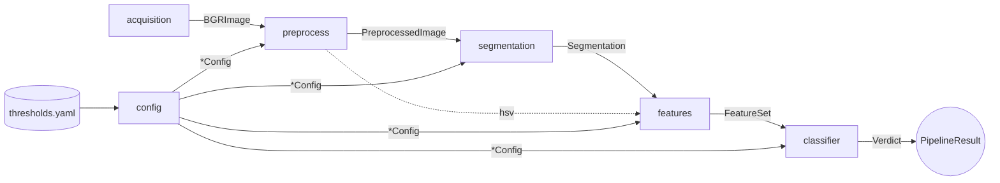

# Arquitectura y contrato entre módulos

## Flujo de datos

`pipeline.BananaPipeline` es el único que encadena las etapas. La app y los scripts
solo hablan con el pipeline.

## Reglas del contrato

| Etapa | Entrada | Salida | Config | Errores |
|---|---|---|---|---|
| `acquisition` | ruta / bytes / cámara | `BGRImage` | — | `ImageLoadError` |
| `preprocess` | `BGRImage` | `PreprocessedImage` | `PreprocessConfig` | `ValueError` |
| `segmentation` | `HSVImage` | `Segmentation` | `SegmentationConfig` | `SegmentationError` |
| `features` | `HSVImage` + `Segmentation` | `FeatureSet` | `FeaturesConfig` | `ValueError` |
| `classifier` | `FeatureSet` | `Verdict` | `ClassifierConfig` | — |
| `pipeline` | `BGRImage` | `PipelineResult` | `Thresholds` | propaga las anteriores |

Invariantes que todos respetan:

1. **Color:** imágenes en BGR `uint8`. HSV en escala OpenCV: **H 0-179**, S y V 0-255.
2. **Máscaras:** `uint8` HxW con valores exactamente 0 o 255.
3. **Proporciones:** siempre fracciones en [0, 1] relativas a los píxeles del plátano.
4. **Inmutabilidad:** las dataclasses son `frozen`; ninguna etapa modifica su entrada.
5. **Configuración inyectada:** cada etapa recibe solo *su* sección de config, nunca
   lee el YAML por su cuenta ni contiene números mágicos.
6. **Errores del dominio:** heredan de `BananaError`; la app los muestra al usuario.

## Cambiar el contrato

`banana/common.py` y `banana/config.py` son compartidos. Un cambio ahí se propone en
un PR propio, lo revisan al menos dos integrantes y se actualiza esta página.
